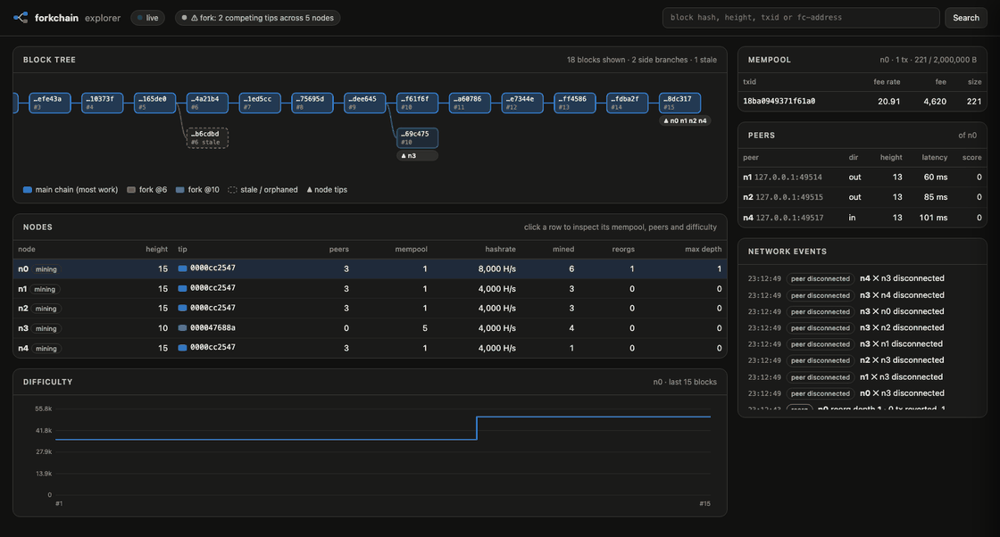
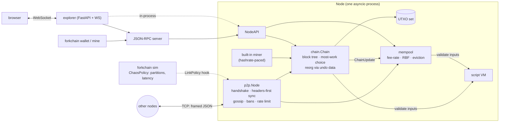
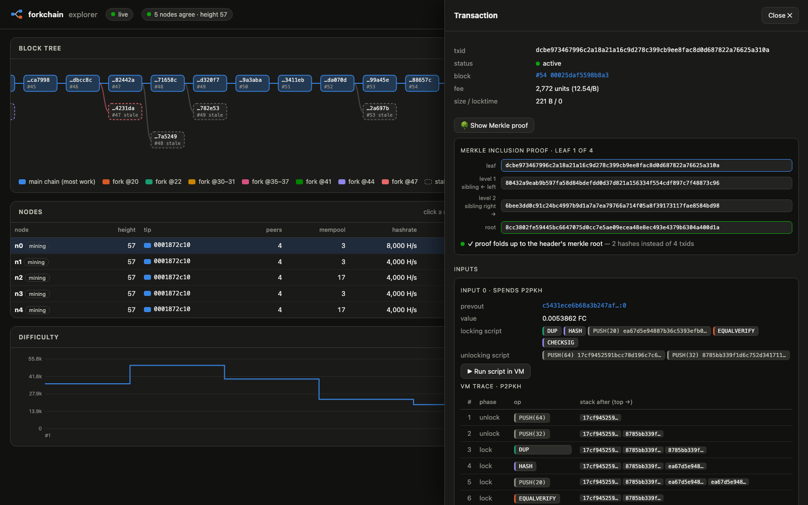

# forkchain

**A from-scratch proof-of-work blockchain in Python: UTXO, a Bitcoin-Script-like VM,
an asyncio P2P network, a chaos simulator and a live explorer that shows forks as they happen.**

> [!WARNING]
> **Educational project, not for real funds.** The cryptography is real (SHA-256d,
> ed25519), but nothing here has been audited. Wallet keys are stored *unencrypted*
> (in a file with `0600` permissions). The RPC has no authentication. Use it to learn
> how blockchains work, never to hold value.



*The explorer during a network partition: node `n3` is cut off and mines its own branch
(green), the rest of the network extends the main chain (blue). After the partition
heals, `n3` reorgs onto the heavier chain and its block is marked stale.*

## Quick start

```bash
git clone <this repo> forkchain && cd forkchain
pip install -e .
forkchain explorer --demo        # open http://127.0.0.1:8080
```

The demo runs five nodes in one process and keeps splitting and healing the network,
so forks and reorgs show up in the explorer within a minute.

Other entry points:

```bash
forkchain sim                    # chaos simulation with a partition, prints a report
forkchain sim --attack           # 51% double-spend attack
docker compose up --build        # 5 mining nodes in containers + explorer on :8080
```

Requires Python 3.11+. Runtime dependencies are `cryptography`, `fastapi` and `uvicorn`.
Networking is plain `asyncio`, with no P2P libraries.

## What's inside

| Area | What is implemented |
|---|---|
| **Blocks & PoW** | 88-byte header (`prev_hash, merkle_root, timestamp, bits, nonce`), SHA-256d, compact `bits` targets, Merkle tree with inclusion proofs |
| **Consensus** | most *cumulative work* wins (not longest chain), difficulty retarget every N blocks with 4× clamp, median-time-past, coinbase reward with halving |
| **UTXO** | Bitcoin-style inputs/outputs, ed25519 signatures over a SIGHASH_ALL digest, coinbase maturity, locktime |
| **Reorgs** | block tree with undo data; disconnect to the fork point, connect the new branch with full validation, fall back if it turns out invalid; reverted txs go back to the mempool |
| **Mempool** | fee-rate priority, one spender per outpoint, full replace-by-fee, byte budget with lowest-fee-rate eviction, unconfirmed chains |
| **Script VM** | stack machine with `DUP HASH EQUAL(VERIFY) VERIFY CHECKSIG(VERIFY) CHECKMULTISIG CHECKLOCKTIME IF/ELSE/ENDIF …`; P2PKH, 2-of-3 multisig, hash-lock, time-lock and HTLC templates; size, op-count and stack limits |
| **P2P** | TCP with a custom framed protocol: version handshake, peer exchange, headers-first sync, block/tx gossip, message size limits, per-peer rate limiting, misbehaviour scores and bans |
| **Simulator** | `forkchain sim`: N real nodes, with partitions, latency/jitter, high-hashrate "whales" and a 51% double-spend attack, then a report |
| **Explorer** | FastAPI + WebSocket, a single HTML file: live fork graph, mempool, peers, difficulty chart, search, Merkle proofs, step-by-step script traces |

## Architecture



```
src/forkchain/
├── encoding.py  crypto.py  keys.py     serialization, hashes, ed25519 + addresses
├── merkle.py  pow.py  params.py         Merkle proofs, targets/retarget, consensus params
├── tx.py  block.py  validation.py       data structures, stateless + contextual checks
├── utxo.py  chain.py                    UTXO set with undo data, block tree, fork choice, reorg
├── mempool.py  miner.py  wallet.py      fee-rate pool + RBF, templates, single-key wallet
├── script/  opcodes.py vm.py templates.py
├── p2p/     protocol.py peer.py node.py
├── api.py  rpc.py  cli.py
├── sim/     policy.py runner.py report.py
└── explorer/ app.py static/index.html
```

## How it works

### Proof of work

A block header is 88 bytes. The nonce comes last, so the miner hashes the first 80 bytes
once and only feeds the nonce for each attempt. A block is valid when
`SHA256(SHA256(header))`, read as a big-endian integer, is at most the target encoded in
`bits` (Bitcoin's compact format). Each block contributes `2^256 / (target + 1)` *work*,
the expected number of hashes needed to find it.

Every `retarget_interval` blocks the target is rescaled by `actual_time / expected_time`,
clamped to 4× in either direction. The window skips genesis, whose fixed timestamp would
otherwise make the first window look arbitrarily slow. Timestamps must be greater than
the median of the last 11 blocks and not too far in the future.

**Fork choice uses cumulative work, not length.** `test_most_work_beats_longest_chain`
builds a 10-block chain at low difficulty and a 6-block chain whose later blocks are 4×
harder; the shorter chain wins.

### Merkle tree

Leaves and inner nodes are domain-separated (`H(0x00‖leaf)`, `H(0x01‖left‖right)`), and an
odd node is promoted instead of being paired with itself. Bitcoin's duplicate-last-node
rule lets `[a, b, c]` and `[a, b, c, c]` share a root (CVE-2012-2459); this design rules
that out. `merkle_proof` / `verify_proof` produce and check an inclusion path of
`⌈log₂ n⌉` hashes. Hypothesis tests check that every proof verifies and that any
tampered step, wrong leaf or changed leaf fails.

### UTXO and signatures

Transactions spend outputs (`txid:index`) and create new ones. The UTXO set holds every
unspent output plus an index by script. Connecting a block records *undo data* (the coins
it consumed), so the block can be disconnected later without a replay. A signature covers
the transaction with all scriptSigs blanked, plus the input index and the script and value
of the spent output (SIGHASH_ALL semantics). The coinbase commits to the block height
(BIP34-style), which keeps coinbase txids unique, and it may claim at most
`reward(height) + fees`. The reward halves every `halving_interval` blocks.

### Reorgs

Every block ever received stays in a tree. When a branch with more total work becomes
complete:

1. find the fork point (lowest common ancestor of the tip and the new best block);
2. disconnect tip → fork point, restoring coins from undo data, one transaction at a
   time, last first;
3. connect the new branch with full validation;
4. if a block fails, mark it and its descendants invalid and re-run the selection. That
   may mean returning to the chain we just left.

The mempool then gets the reverted transactions back, in chain order, and re-validates
everything against the new tip. A transaction whose input is now spent by the winning
branch is dropped. That is exactly how a double spend succeeds, and the tests and the
simulator count it.

### Script VM

`script_sig` (push-only) runs first, then the spent output's `script_pubkey` on the same
stack. The input is valid if the top of the stack is truthy at the end.

| Template | Locking script |
|---|---|
| P2PKH | `DUP HASH <pkh> EQUALVERIFY CHECKSIG` |
| 2-of-3 multisig | `OP_2 <pk1> <pk2> <pk3> OP_3 CHECKMULTISIG` |
| hash-lock | `HASH <h> EQUALVERIFY DUP HASH <pkh> EQUALVERIFY CHECKSIG` |
| time-lock | `<height> CHECKLOCKTIME DROP DUP HASH <pkh> EQUALVERIFY CHECKSIG` |
| HTLC | `IF <hash-lock> ELSE <time-lock refund> ENDIF EQUALVERIFY CHECKSIG` |

`CHECKLOCKTIME` follows BIP65: it compares against the spending transaction's `locktime`
(which consensus enforces against block height), so the result never depends on which
block the transaction lands in. Limits: 1000-byte scripts, 100 operations (each key in
`CHECKMULTISIG` counts), 100 stack items, 520-byte elements. A hypothesis fuzzer feeds
random bytes and random opcode sequences and checks that the VM only ever fails with a
clean `ScriptError`.

### P2P

Each frame is `magic(4) | command(12) | length(4) | checksum(4) | JSON payload`. The length
is checked against the limit *before* the body is read. Blocks and transactions travel as
hex of their canonical binary form.

- **Handshake:** `version`/`verack` with protocol version, node id (detects
  self-connections and duplicate links) and listen address.
- **Sync is headers-first:** `getheaders` with a block locator, then headers are validated
  (PoW, linkage, difficulty, time), and only then are the bodies of the most-work header
  chain downloaded, at most 64 blocks in flight.
- **Gossip:** new blocks are announced with `headers`, transactions with `inv` →
  `getdata`. Peers exchange addresses with `getaddr`/`addr`.
- **Abuse handling:** a token bucket per peer, and a misbehaviour score that bans at 100
  (by address and node id). Garbage bytes, oversized frames, invalid PoW, invalid blocks
  and messages before the handshake are all covered by tests.

### Chaos simulator

`forkchain sim` starts N unmodified `Node`s over localhost TCP in one process. Faults go
through the node's `LinkPolicy` hook. A partition really tears down the TCP links, and
the healed network has to find its way back through peer discovery and headers-first
sync. Hashrate is real hashing, paced against a running budget, so a "whale" with 4× the
hashrate really finds about 4× the blocks. The run used for this README:

```
$ forkchain sim --nodes 5 --duration 40 --partition 10:25 --whales 1 --latency 60 --jitter 40 --tx-rate 3
──────────────────────────────────────────────────────────────────
 forkchain chaos simulation report
──────────────────────────────────────────────────────────────────
 nodes                     5
 wall time                 40.7s
 target block time         1.0s
 final height / tip        32 / 0001949488136f51…
 converged                 yes

 blocks mined (all nodes)  47
 stale (orphaned) blocks   15
 forks (fork points)       8
 reorgs (all nodes)        19
 deepest reorg             7 blocks

 txs sent / confirmed      101 / 100
 txs reverted by reorgs    25
   ...lost (double-spent)  0

 partition window          10.0s → 25.0s
 convergence after heal    0.63s
 settle after mining stop  0.20s
 difficulty                32,000 → 40,685

 node  hashrate  share  mined  in-chain  reorgs  max-depth  bans
 n0      16,000    50%     22        20       2          2     0
 n1       4,000    12%      3         1       4          1     0
 n2       4,000    12%      4         2       5          7     0
 n3       4,000    12%      6         3       5          7     0
 n4       4,000    12%     12         6       3          7     0
```

The `{n0, n1}` side held 62% of the hashrate, so when the partition healed, `n2..n4`
reorged 7 blocks deep. 25 transactions left the chain, and all of them were re-mined
from the mempool.

With `--attack`, node `n0` gets more than 50% of the hashrate and runs the classic double
spend: it goes dark, pays a merchant on the public network, and spends the same coin to
itself on a private chain. Once the merchant has seen `--confirmations` blocks, it
releases the heavier private chain. The report says whether the merchant's payment
vanished.

The simulator also found a real bug during development: disconnecting a block that
contained both a transaction and a child spending it failed, because all outputs were
removed before any input was restored. See commit `fix(utxo): …` and its regression
tests.

### Explorer

The backend polls every node (in-process or over JSON-RPC) and **merges their block
trees**. Each node follows only one branch, so a fork becomes visible only when you look
at several nodes at once. The page lays out the main chain (path to the heaviest tip) on
lane 0 and gives every side branch its own lane and color. Stale blocks are dashed, and
each node's tip is labelled. Clicking a block or transaction opens its details, including
the Merkle path up to the header root and a step-by-step VM trace of any input:



## CLI reference

```bash
forkchain node    --name n1 --port 8333 --rpc-port 8332 --peer host:port --mine --address fc… [--hashrate H/s] [--network main|regtest]
forkchain wallet  [--wallet PATH] new | address | balance [--rpc host:port] | send ADDRESS AMOUNT [--fee-rate units/B]
forkchain mine    --rpc host:port --address fc… [--blocks N]       # external getblocktemplate-style miner
forkchain sim     [--nodes 5] [--duration 40] [--partition 10:25|none] [--groups "n0,n1|n2,n3,n4"]
                  [--latency ms] [--jitter ms] [--slow n3:500] [--whales 2 --whale-factor 4]
                  [--attack] [--tx-rate 2] [--json] [--explorer-port 8080]
forkchain explorer [--rpc host:port ...] [--demo] [--port 8080]
```

A local two-node network by hand:

```bash
forkchain wallet new                                   # ~/.forkchain/wallet.json, mode 600
ADDR=$(forkchain wallet address)
forkchain node --name a --port 8333 --rpc-port 8332 --mine --address $ADDR --hashrate 50000 &
forkchain node --name b --port 8334 --rpc-port 8342 --peer 127.0.0.1:8333 &
forkchain wallet balance                               # coinbase matures after 10 blocks
forkchain wallet send fc… 1.5
forkchain explorer --rpc 127.0.0.1:8332 --rpc 127.0.0.1:8342
```

## Development

```bash
pip install -e ".[dev]"
ruff check . && ruff format --check .
mypy                       # strict
pytest --cov=forkchain     # 213 tests, ~35 s
```

- **Coverage:** 93% overall, 96% for the consensus core (blocks, chain, UTXO, mempool,
  VM). CI enforces 85% overall and 90% for the core.
- **Property-based tests (hypothesis):** Merkle proofs, header and byte-level block
  tampering, varint round-trips, compact-target round-trips, VM fuzzing, and *random
  fork sequences whose final UTXO set must equal a clean replay of the active chain*.
- **Scenario tests:** reorg, double spend inside a block / across blocks / via a 51%
  reorg, invalid heavier branch, orphans, out-of-order headers-first download,
  convergence of 5 nodes after a partition, a successful majority attack, peer bans and
  rate limiting.
- **CI** (GitHub Actions): lint + strict mypy, tests on Python 3.11 and 3.12, Docker image
  build with an in-container simulation smoke test.

## Limitations and what is not implemented

This is a teaching model of Bitcoin, not a re-implementation. Deliberate simplifications:

- **No persistence.** Chain state lives in memory, and a restarted node re-syncs from its
  peers.
- **No SegWit, no P2SH, no Taproot.** Multisig is bare. txids include signatures (ed25519
  signatures are not malleable the way ECDSA ones are, but the txid still commits to the
  witness).
- **`HASH` is truncated SHA-256 (160 bits)**, not RIPEMD160(SHA256). Script integers are
  unsigned little-endian. There is no arithmetic, no `CHECKSEQUENCEVERIFY`, and
  `CHECKMULTISIG` has no dummy-element bug.
- **Locktime is height-only and always enforced** (no sequence-based opt-out, no
  relative locktimes).
- **Mempool:** no orphan-transaction pool (a tx spending unknown outputs is dropped), no
  package/CPFP relay, and eviction does not use ancestor fee rates.
- **P2P:** JSON payloads over plaintext TCP, no encryption (BIP324), no compact blocks,
  no address manager with buckets, so it is not eclipse-resistant. The ban list is in
  memory.
- **Fork choice ignores checkpoints and assumevalid**, and the whole block tree is kept
  in memory with no pruning.
- **Wallet:** one key, keys unencrypted on disk, no HD derivation, no coin control
  beyond largest-first.
- **RPC has no authentication** and binds to `127.0.0.1` by default. In
  `docker-compose.yml` it is reachable only inside the compose network.
- **The simulator runs all nodes in one process**, with hashrate paced on a shared CPU.
  In the Docker network the nodes are real separate processes, but fault injection is
  only available in-process.

## License

[MIT](LICENSE)
